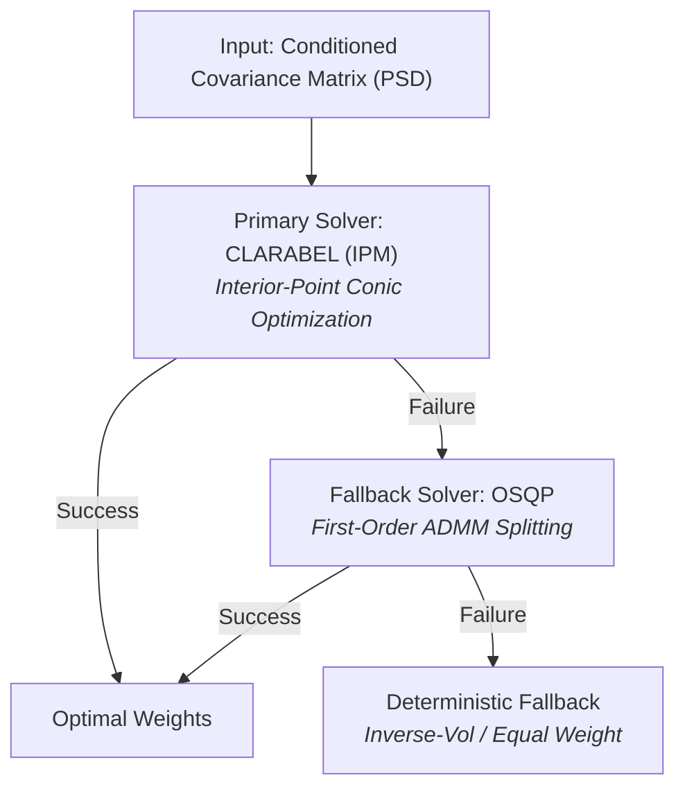

# Convex Quality Optimization & Covariance Estimation Architecture

## 1. Overview
The `src/optimizer.py` module supplies risk models and convex quadratic optimization routines for Milestone 3 of the Black CEO Portfolio backtesting platform. Because the active constituent universe $N_t$ is sparse (historically ranging between 1 and 8 firms), standard sample covariance matrix estimation suffers from extreme estimation error, eigenvalue dispersion, and near-singular conditioning. 

To ensure numerical stability and robust risk budgeting, the engine implements Ledoit-Wolf (2004) analytical shrinkage and spectral ridge regularizations.

---

## 2. Mathematical Formulation: Ledoit-Wolf Shrinkage

Given an active asset return matrix $X \in \mathbb{R}^{T \times N}$ across a historical lookback window $T$ (default: 252 sessions) and $N$ active assets:

### 2.1 Sample Covariance Matrix
Let $\bar{x} \in \mathbb{R}^N$ denote the sample mean return vector:
$$\bar{x} = \frac{1}{T} \sum_{t=1}^T x_t$$

The unbiased sample covariance matrix $S \in \mathbb{R}^{N \times N}$ is:
$$S = \frac{1}{T - 1} \sum_{t=1}^T (x_t - \bar{x})(x_t - \bar{x})^\top$$

When $N$ approaches $T$ (or when single-stock returns exhibit strong collinearity), the sample covariance matrix $S$ over-disperses eigenvalues: the largest eigenvalues are biased upward and the smallest eigenvalues are biased toward zero. Inverting $S$ in a Mean-Variance or Minimum-Variance optimization produces erratic and concentrated weights.

### 2.2 Shrinkage Target ($F$)
Ledoit & Wolf (2004) introduce a structured shrinkage target $F$ defined as the constant-correlation or scaled identity matrix. For our default formulation, we target average sample variance scaled across the identity:
$$\mu = \frac{1}{N} \text{Tr}(S)$$
$$F = \mu I_N$$

Where:
* $I_N$ is the $N \times N$ identity matrix.
* $\mu$ is the cross-sectional mean variance of the active universe.

### 2.3 Optimal Convex Shrinkage Intensity ($\delta^{\ast}$)
The regularized covariance matrix $\Sigma^{\ast}$ is a convex linear combination of the sample covariance matrix $S$ and the structured target $F$:

$$\Sigma^{\ast} = (1 - \delta^{\ast}) S + \delta^{\ast} F, \quad \delta^{\ast} \in [0, 1]$$

The optimal shrinkage intensity $\delta^{\ast}$ minimizes the expected quadratic loss under the Frobenius norm:

$$L(\delta) = \|\Sigma^{\ast} - \Sigma_{\text{true}}\|_{F}^{2}$$

Analytically, $\delta^{\ast}$ is estimated via:

$$\delta^{\ast} = \max\left(0, \, \min\left(1, \, \frac{\kappa}{T}\right)\right)$$

where $\kappa = \frac{\pi - \rho}{\gamma}$ measures the asymptotic variance of the sample covariance entries relative to the squared distance to the shrinkage target $F$, and $T$ is the number of historical sample observations.

---

## 3. Numerical Conditioning for Low-Sample Regimes (#151)

During transitions where an asset has recently entered the universe or historical data spans fewer than $T_{\min} = 63$ trading days, additional conditioning guarantees strict positive definiteness:

1. **Symmetric Projection:**
   $$\Sigma_{\text{sym}} = \frac{1}{2} (\Sigma^* + (\Sigma^*)^\top)$$
2. **Spectral Eigenvalue Clipping (Ridge Regularization):**
   Compute the spectral decomposition:
   $$\Sigma_{\text{sym}} = V \Lambda V^\top, \quad \Lambda = \text{diag}(\lambda_1, \dots, \lambda_N)$$
   Floor eigenvalues by a numerical buffer $\epsilon = 10^{-4}$:
   $$\tilde{\Lambda} = \text{diag}(\max(\lambda_i, \epsilon))$$
   Reconstruct:
   $$\tilde{\Sigma} = V \tilde{\Lambda} V^\top + \epsilon I_N$$
3. **Strict Positive Definiteness Invariant:**
   Guarantees for any non-zero allocation vector $w \neq 0$:
   $$w^\top \tilde{\Sigma} w > 0$$

---

## 4. Integration with CVXPY Solvers

In subsequent Day 13–16 routines, $\tilde{\Sigma}$ serves as the quadratic risk term in convex programs:
$$\min_{w} \quad \frac{1}{2} w^\top \tilde{\Sigma} w - q^\top w$$
$$\text{subject to} \quad \mathbf{1}^\top w = 1, \quad 0 \le w_i \le \min\left(0.35, \frac{2}{N_t}\right)$$

Because $\tilde{\Sigma} \succ 0$, the Hessian is strictly positive definite, guaranteeing unique global convergence under OSQP and CLARABEL interior-point solvers.

## Heuristic Benchmark: Inverse-Volatility Risk Parity Allocation

### 1. Motivation & Mathematical Formulation
Naive equal-weighting ($w_i = 1/N_t$) assumes identical variance across all portfolio assets. In an all-cap universe containing both large-cap blue chips and small/micro-cap equities, equal-weighting allows high-variance idiosyncratic noise to dominate portfolio return and volatility.

Inverse-volatility allocation budgets portfolio capital inversely to each active asset's trailing sample standard deviation. Over a rolling lookback window $L = 63$ trading sessions (approximately one business quarter):

$$\sigma_{i, t} = \sqrt{\frac{1}{L - 1} \sum_{\tau=t-L+1}^{t} \left( r_{i, \tau} - \bar{r}_{i, t} \right)^2}$$

### 2. Numerical Regularization ($\epsilon$ Floor)
To prevent division-by-zero errors or numerical instability when an asset exhibits zero or near-zero variance (e.g., newly listed assets or trading halts), an analytical floor $\epsilon = 10^{-4}$ is applied:

$$\tilde{\sigma}_{i, t} = \max(\sigma_{i, t}, \, \epsilon)$$

The unnormalized inverse-volatility weight for active constituent $i \in \mathcal{A}_t$ is:

$$w_{i, t}^{\text{raw}} = \frac{1}{\tilde{\sigma}_{i, t}}$$

### 3. Budget Normalization & Concentration Defense
Let $N_t = |\mathcal{A}_t|$ denote the number of active Black CEO constituents on date $t$. The total portfolio equity budget $B_t$ is determined by the concentration defense rule:

$$B_t = \begin{cases} 
0.0 & \text{if } N_t = 0 \\ 
\frac{1}{3} & \text{if } 1 \le N_t < 3 \\ 
1.0 & \text{if } N_t \ge 3 
\end{cases}$$

The final portfolio weight for asset $i$ is:

$$w_{i, t} = B_t \cdot \frac{w_{i, t}^{\text{raw}}}{\sum_{j \in \mathcal{A}_t} w_{j, t}^{\text{raw}}}$$

The remaining allocation $(1 - B_t)$ sits in risk-free cash, dampening drawdown risk during periods of universe sparsity.

---

## 4. Convex Quadratic Program (QP) Formulation & Solver Architecture

### 4.1 Quadratic Program Specification (#162, #163, #164)
The minimum-variance portfolio allocation is formulated as a convex quadratic program over the decision variable vector $w \in \mathbb{R}^N$:

$$\min_{w} \quad \frac{1}{2} w^{\top} \Sigma^{*} w$$

$$\text{subject to} \quad w \ge 0, \quad \sum_{i=1}^{N} w_i = B_t$$

where $\Sigma^{*} \in \mathbb{S}_{+}^{N}$ is the Ledoit-Wolf shrunk, PSD-conditioned covariance matrix, and $B_t \in \{0, \frac{1}{3}, 1.0\}$ represents the active equity budget under the concentration defense rule.

### 4.2 Solver Selection Rationale: CLARABEL vs. OSQP (#165)

`ConvexPortfolioOptimizer` implements a dual-solver hierarchy designed for robust, zero-crash execution across historical market regimes:

---

---

## 5. Fundamental Quality Score Formulation & Objective Tilts

### 5.1 Point-in-Time Quality Proxy Vector ($q_t$) (#168)
To avoid look-ahead and restatement bias across historical constituents (including delisted equities such as `JCP`, `WBA`, and `QRTEA`), the quality scoring vector $q_t \in \mathbb{R}^N$ is formulated strictly from point-in-time historical price action prior to trading session $t$:

1. **Risk-Adjusted Drift ($12\text{–}1$ Month Information Ratio):**
   Computed over the trailing 252-day window ending 21 trading days prior to $t$ ($[t-252, \, t-21)$) to capture persistent operational outperformance while avoiding short-term reversal contamination:
   $$S_{\text{drift}, i, t} = \frac{\mu_{i, [t-252, t-21)}}{\max(\sigma_{i, [t-252, t-21)}, \epsilon)}$$

2. **Downside Stability Factor (Low-Risk Quality Proxy):**
   Computed as the negative trailing 63-day realized downside semi-deviation over $[t-63, \, t)$:
   $$S_{\text{stab}, i, t} = -\sqrt{\frac{1}{63} \sum_{\tau=t-63}^{t-1} \min(r_{i, \tau}, 0)^2}$$

### 5.2 Cross-Sectional Peer Z-Score Normalization (#170)
Raw sub-factors are standardized cross-sectionally strictly across the active constituent cohort $\mathcal{A}_t = \{i : \text{mask}_{t,i} = \text{True}\}$ on date $t$:

$$z_{i, t} = \text{clip}\left( \frac{S_{i, t} - \mu_{\mathcal{A}_t}}{\sigma_{\mathcal{A}_t}}, \, -3.0, \, +3.0 \right)$$

* **Equal Blending & Re-Standardization:** The normalized sub-factors are combined ($0.5 \, z_{\text{drift}, i, t} + 0.5 \, z_{\text{stab}, i, t}$) and re-standardized across $\mathcal{A}_t$ so $q_t$ maintains zero cross-sectional mean and unit variance.
* **Inactive & Sparse Universe Guards:** Inactive constituents ($i \notin \mathcal{A}_t$) strictly receive $q_{i, t} = 0.0$. When $N_t < 2$ or $\sigma_{\mathcal{A}_t} < 10^{-6}$, $q_t = \mathbf{0}$ so the optimizer reverts cleanly to pure minimum variance.

### 5.3 Linear Quality Tilt Objective Function (#169)
The convex quadratic program integrates the quality vector via a linear reward term scaled by tilt intensity $\lambda \ge 0$:

$$\min_{w} \quad \frac{1}{2} w^{\top} \Sigma^{*} w - \lambda \, q_t^{\top} w$$

$$\text{subject to} \quad w \ge 0, \quad \sum_{i=1}^{N} w_i = B_t$$

Because $-\lambda \, q_t^{\top} w$ is affine in $w$ and $\Sigma^{*} \in \mathbb{S}_{+}^{N}$ is positive semi-definite, the composite objective remains strictly convex and Disciplined Convex Programming (DCP) compliant.
